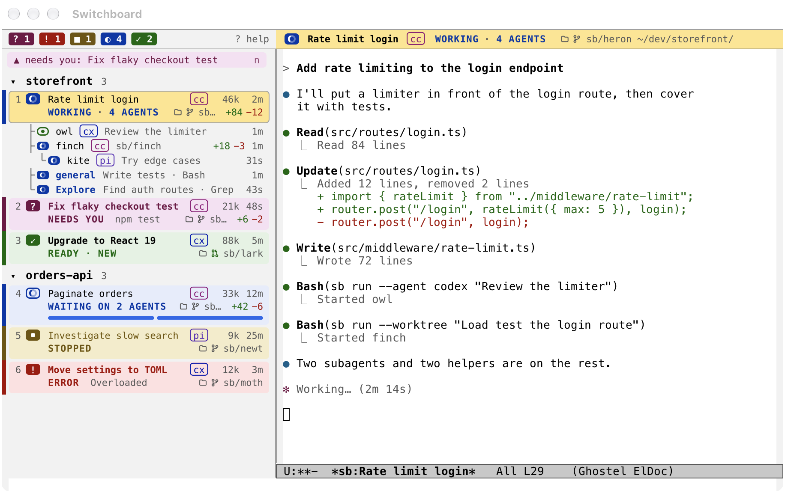
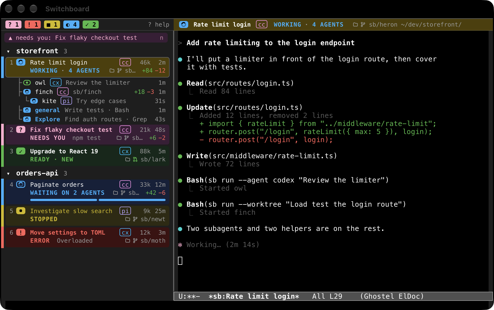
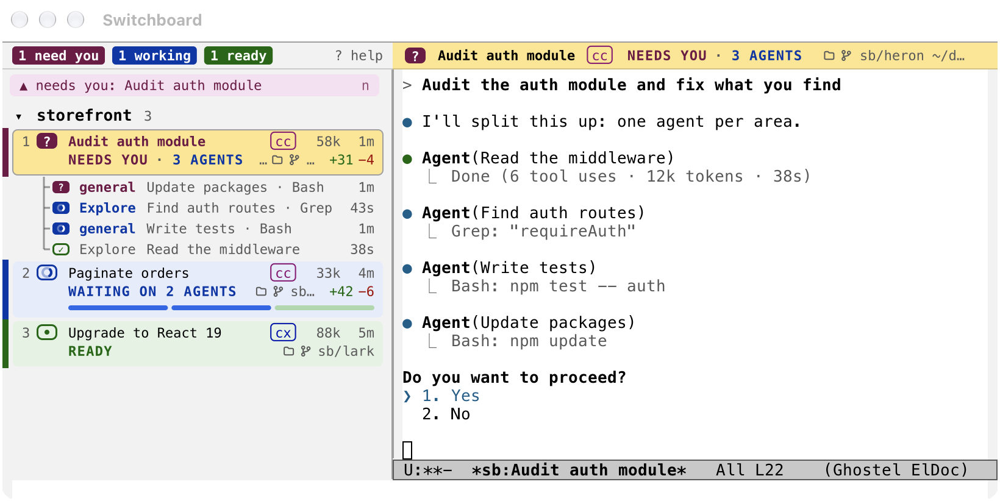
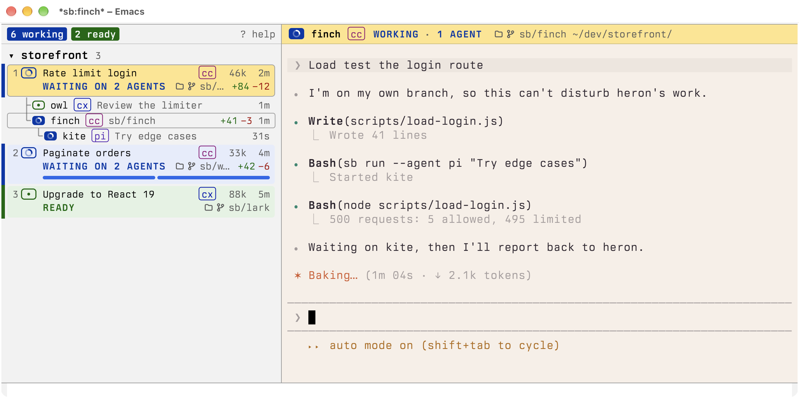
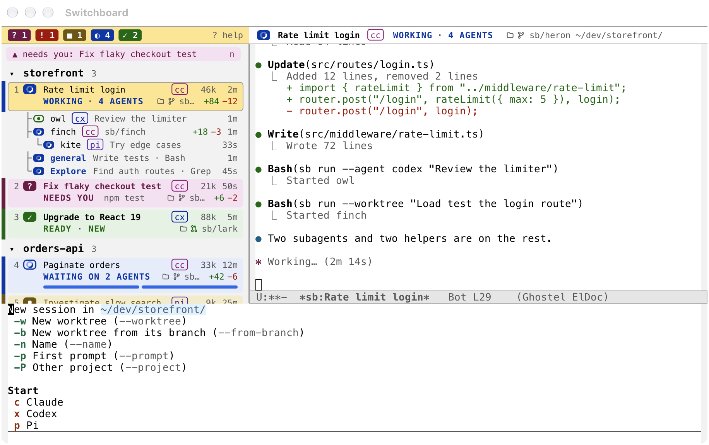

# Switchboard

A sidebar in Emacs that lists your coding agent sessions and shows what each one is doing. It supports Claude Code, Codex and Pi. Each agent runs in its own [ghostel](https://github.com/dakra/ghostel) terminal, usually in its own git worktree.



<details>
<summary>Dark theme</summary>



</details>

The screenshots show sample data, with Emacs's built-in Modus themes.

| Status | Meaning |
| --- | --- |
| WORKING | The agent is mid-turn |
| WAITING ON AGENTS | Its turn ended, but subagents it started still run |
| NEEDS YOU | It is waiting on a permission prompt |
| ERROR | The turn died on an API error |
| STOPPED | You interrupted it with Esc |
| READY | It finished and waits for your next prompt |
| EXITED | The process is gone; `r` resumes it |

Subagents a session starts are listed under it, each with the tool it's running. Sessions you aren't looking at show them as a bar instead, with one segment per agent. A subagent that needs permission turns its session to NEEDS YOU.



Agents can also start each other as helpers with the `sb` command. Each helper gets its own terminal, and can run a different agent or use its own worktree. Helpers are listed under the session that started them, and can start helpers of their own. Run `bin/sb --skill` for the manual.



Switchboard is developed on macOS. It hasn't been tried on Linux, where its notifications and some scripts won't work yet.

## Requirements

- Emacs 30.1 or newer with SVG and dynamic module support. So far it has only been run on 31.1.
- [ghostel](https://melpa.org/#/ghostel), from MELPA. It needs a native module; see [First session](#first-session).
- At least one of `claude`, `codex` or `pi`.
- `git`.

Optional:

- `jq` keeps large hook payloads out of Emacs.
- `terminal-notifier` makes notifications clickable. Without it they come from `osascript`, and clicking them does nothing.
- `gh` shows pull request state.
- [magit](https://magit.vc), for `d` in the list.
- [evil-ghostel](https://melpa.org/#/evil-ghostel), if you use evil.

```sh
brew install jq terminal-notifier gh
```

## Install

Switchboard doesn't bind any global keys itself. The bindings below are the suggested layout, so copy them or change them as you like.

| Key | Command | What it does |
| --- | --- | --- |
| `SPC e e` | `switchboard` | Show the session list |
| `SPC e c` | `switchboard-new` | Start a new session |
| `SPC e w` | `switchboard-toggle-focus` | Move between the list and the terminal |
| `SPC e n` | `switchboard-next-attention` | Go to the next session that needs you |
| `SPC e r` | `switchboard-resume-all` | Resume all sessions |
| `SPC e s` | `switchboard-shell` | Toggle a shell in the session's worktree |
| `SPC e z` | `switchboard-zoom` | Zoom the agent or its shell |
| `Cmd-{` | `switchboard-previous-session` | Go to the previous session |
| `Cmd-}` | `switchboard-next-session` | Go to the next session |
| `Cmd-Shift-Return` | `switchboard-zoom` | Zoom the agent or its shell |

### Doom

In `packages.el`:

```elisp
(package! switchboard
  :recipe (:host github :repo "arturopuente/switchboard"
           :files ("switchboard.el" "switchboard-hook.sh" "switchboard-pi.ts" "bin")))
```

Then run `doom sync`, and add the bindings to `config.el`:

```elisp
(map! "s-{" #'switchboard-previous-session
      "s-}" #'switchboard-next-session
      "s-S-<return>" #'switchboard-zoom)

(map! :leader
      (:prefix ("e" . "agents")
       :desc "Session list"         "e" #'switchboard
       :desc "List <-> terminal"    "w" #'switchboard-toggle-focus
       :desc "New session"          "c" #'switchboard-new
       :desc "Next needing you"     "n" #'switchboard-next-attention
       :desc "Resume all sessions"  "r" #'switchboard-resume-all
       :desc "Shell in worktree"    "s" #'switchboard-shell
       :desc "Zoom agent/shell"     "z" #'switchboard-zoom))
```

### Other setups

Add MELPA to `package-archives` first, so that ghostel can be installed. `SPC` is only a leader key in Doom and similar setups, so this uses the same letters under `C-c e`. With `use-package` (Emacs 30 or newer):

```elisp
(use-package switchboard
  :vc (:url "https://github.com/arturopuente/switchboard" :rev :newest)
  :bind (("C-c e e" . switchboard)
         ("C-c e w" . switchboard-toggle-focus)
         ("C-c e c" . switchboard-new)
         ("C-c e n" . switchboard-next-attention)
         ("C-c e r" . switchboard-resume-all)
         ("C-c e s" . switchboard-shell)
         ("C-c e z" . switchboard-zoom)
         ("s-{" . switchboard-previous-session)
         ("s-}" . switchboard-next-session)
         ("s-S-<return>" . switchboard-zoom)))
```

## macOS setup

**PATH.** Emacs started from the Dock doesn't get your shell's PATH, so it may not find `claude`, `codex` or `emacsclient`. Doom handles this with `doom env`. In other setups, use [exec-path-from-shell](https://github.com/purcell/exec-path-from-shell).

**Notifications.** `terminal-notifier` stays silent until macOS has asked you to allow it, and only launching it as an app brings up that prompt:

```sh
open -W -a "$(brew --prefix terminal-notifier)/terminal-notifier.app" \
  --args -title Switchboard -message "Notifications are on"
```

**Cmd keys.** Inside its terminals, Switchboard maps Cmd keys such as Cmd-V for paste. See `switchboard-terminal-keys` to change them.

## Use

`M-x switchboard` opens the list. Press `c` to start a session and `?` to see every key.

To have Emacs open on the list when it starts without a file or directory to open, such as from the Dock, add this to your config. It's off by default.

```elisp
(setq switchboard-open-at-startup t)
```



Sessions use their own settings, so your global Claude Code and Codex configuration isn't changed. New worktrees go in `~/.worktrees/`; set `switchboard-worktree-directory` to change that. `M-x customize-group RET switchboard` lists the other options.

**Codex.** Codex skips hooks until you trust them, so run `/hooks` in a Codex session once. You need to do this again if Switchboard's folder moves. Until then, Switchboard falls back to Codex's `notify`, which shows less detail.

## First session

The first time you start a session, ghostel asks what to do about its native module. Press `d` to download a pre-built one. The session's row already says READY at this point, and the agent starts once the download finishes.

To skip the question, add this to your config:

```elisp
(setq ghostel-module-auto-install 'download)
```

## What Switchboard adds to your agents

Switchboard changes how it starts each agent. These changes apply only to sessions it starts, and there's no setting to turn them off yet.

| Agent | What it adds |
| --- | --- |
| Claude Code | Hooks that report events, a line in the system prompt about `sb`, and permission to run `sb` without asking |
| Codex | Hooks and `notify` that report events, a line in its developer instructions about `sb`, and write access to Switchboard's request folder for `sb` |
| Pi | An extension that reports events, and a line in the system prompt about `sb` |

**Helpers.** Because of this, an agent can start other agents on its own, and under Claude Code it won't ask you first. Helpers can start helpers one level down, and a session and its helpers can have 10 running at once. Permission prompts still come to you, because `sb send` refuses to answer them.

**Your data.** Hook events go from the agent to Emacs on your machine. Switchboard itself sends nothing elsewhere, except that `gh` asks GitHub about each session's pull request if you have it installed.

## Tests

```sh
./test.sh
```

## License

GPL-3.0-or-later. See [LICENSE](LICENSE).
